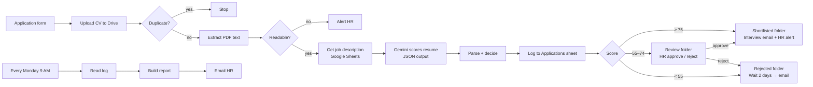

# HR Automater: AI Resume Screening with n8n + Gemini

An end-to-end hiring automation built in **n8n**. Candidates apply through a web form, **Google Gemini** scores each resume against the job description, and the workflow sorts, logs and emails candidates. HR reviews only the borderline cases.

> Screening a resume by hand takes several minutes. This workflow scores it, explains the score, files it and replies to the candidate within seconds.


---

## Features

- **Application form** with required fields, PDF-only upload and a data-consent checkbox
- **Duplicate detection**: the same email applying twice for the same role is skipped
- **AI scoring (0–100)** with a fixed rubric: skills 40, experience 30, education 15, overall fit 15
- **Explainable results**: matched skills, missing skills and a 2-sentence summary for every candidate
- **Prompt-injection protection**: instructions hidden inside a resume are ignored
- **Three-way routing with a human in the loop**
  - **≥ 75** → shortlisted, interview booking link emailed, HR alerted
  - **55–74** → HR gets an email with **Shortlist / Reject** buttons
  - **< 55** → rejected, polite email sent after a 2-day delay
- **Unreadable CV handling**: scanned or empty PDFs go to HR instead of getting a guessed score
- **Applications log** in Google Sheets for every candidate
- **Weekly report** emailed to HR every Monday: applications per role, average scores, top 5 candidates, estimated hours saved

## Architecture



## Tech stack

| Area | Tool |
|---|---|
| Automation | n8n |
| AI model | Google Gemini (via n8n LangChain node) |
| Storage | Google Drive (CV folders), Google Sheets (job descriptions + log) |
| Email | Gmail (notifications, HR approval buttons, weekly report) |
| Logic | JavaScript (n8n Code nodes) |

## Repository structure

```
hr-automater/
├── workflow/
│   └── hr-automater-v2.json            # n8n workflow (import this)
├── templates/
│   ├── job_descriptions_sample.csv     # sample Role / Job Description sheet
│   └── applications_log_template.csv   # headers for the Applications log
├── docs/
│   └── screenshots/                    # workflow, form, emails, dashboard
└── README.md
```

## Setup

### 1. Google Sheets
1. **Job descriptions**: import `templates/job_descriptions_sample.csv` into a new Google Sheet. The `Role` values must match the form's dropdown options exactly.
2. **Applications log**: create a Google Sheet with a tab named **`Applications`** and paste the headers from `templates/applications_log_template.csv` into row 1.

### 2. Google Drive
Create four folders: an inbox folder for new CVs, plus **shortlisted**, **review** and **rejected**.

### 3. n8n
1. **Workflows → Import from File** → `workflow/hr-automater-v2.json`
2. Connect credentials: Google Drive, Google Sheets, Gmail and Google Gemini (PaLM API).
3. Replace every `YOUR_...` placeholder:

| Placeholder | Where |
|---|---|
| `YOUR_JOB_DESCRIPTIONS_SHEET_ID` | Get job description |
| `YOUR_APPLICATIONS_LOG_SHEET_ID` | Check duplicate, Log to Applications sheet, Read Applications log |
| `YOUR_RESUME_INBOX_FOLDER_ID` | Upload file |
| `YOUR_SHORTLISTED_FOLDER_ID` / `YOUR_REVIEW_FOLDER_ID` / `YOUR_REJECTED_FOLDER_ID` | Move nodes |
| `YOUR_HR_EMAIL` | HR alert, HR approval, weekly report |
| `YOUR_INTERVIEW_BOOKING_LINK` | Email candidate: shortlisted |

4. Optional: change the thresholds (75 / 55) at the top of the **Parse AI result** node.
5. Activate the workflow and share the form's production URL.

> The HR approval step and the 2-day delay need n8n to keep running (n8n Cloud or a server).

## How the scoring works

Gemini receives the job description and the resume text, separated by clear delimiters, and must return only JSON:

```json
{
  "score": 82,
  "matched_skills": ["Python", "React", "SQL"],
  "missing_skills": ["Docker"],
  "summary": "Strong full-stack profile matching most required skills. Lacks container experience."
}
```

A Code node validates the JSON, clamps the score to 0–100, and sends the candidate to **Review** if the output can't be parsed, so nobody is rejected because of a model error.

## Responsible AI

- The AI never makes a final rejection on borderline candidates; HR decides.
- The prompt tells the model to ignore name, gender, age, nationality, religion and photos.
- Candidates give consent before their resume is stored.
- Rejection emails are delayed and written politely.

## Results

<!-- Fill these in from your own testing -->
- Resumes processed: _X_
- Average time per resume: _X seconds_ (vs _X minutes_ manually)
- Agreement with human HR decisions: _X%_ on _N_ test resumes

## Screenshots

| Application form | Shortlist email | Applications log |
|---|---|---|
|  |  |  |

## Roadmap

- [ ] Support .docx resumes
- [ ] Suggest a better-fitting role when a candidate scores low for the one they chose
- [ ] Looker Studio dashboard on the Applications log
- [ ] Slack / WhatsApp alerts for HR

## Author

**[Your Name]**: [LinkedIn](https://linkedin.com/in/your-profile) · [Portfolio](https://your-site.com)

## License

MIT
